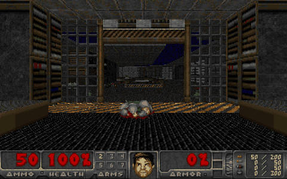
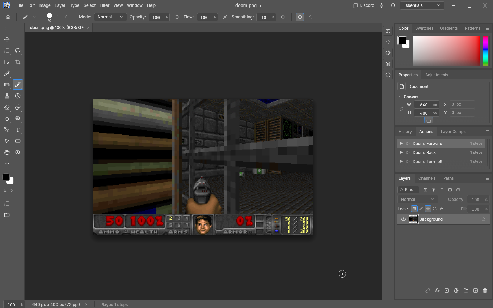
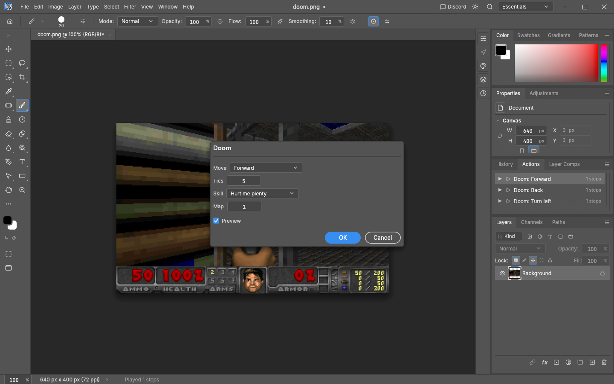

# Doom in PhotoCraft

Play Doom inside [PhotoCraft](https://github.com/storytold/photocraft), the open-source image
editor, right on the canvas. The game is [Freedoom](https://freedoom.github.io/) (episode 1). Each
move is one run of a filter plug-in, and the saved game is kept in the picture itself.





## Install

Close PhotoCraft first.

**Linux and macOS**

```sh
curl -fsSL https://raw.githubusercontent.com/emircesur/doom-in-photocraft/main/install.sh | sh
```

**Windows** (PowerShell)

```powershell
irm https://raw.githubusercontent.com/emircesur/doom-in-photocraft/main/install.ps1 | iex
```

**With [CraftSpace](https://github.com/emircesur/CRAFTSPACE)**: Fonts & add-ons › Doom for
PhotoCraft (or `craftspace-cli addons install craftspace-doom`).

The installers download the plug-in from the [latest release](https://github.com/emircesur/doom-in-photocraft/releases/latest)
and check its SHA-256. They put it in PhotoCraft's additional plug-ins folder (Preferences ›
Plug-ins), using `<settings>/Plug-ins` if none is set. They also add the Doom moves to Window ›
Actions and give them Alt+Shift keys, leaving alone any key you already use. To remove it, run
the script again with `--uninstall` (`-Uninstall` on Windows). For a portable PhotoCraft, pass
its data folder with `--config DIR` (`-Config DIR`).

<details>
<summary>By hand</summary>

1. Download `doom-photocraft.wasm` and `doom-actions.json` from the
   [latest release](https://github.com/emircesur/doom-in-photocraft/releases/latest).
2. Put `doom-photocraft.wasm` in a folder, then in PhotoCraft open Edit › Preferences ›
   Plug-ins, turn on *Use Additional Plug-ins Folder* and choose that folder.
3. Quit PhotoCraft. Add the actions from `doom-actions.json` to the `actions` list in
   `Presets/actions.json` in PhotoCraft's settings folder (create the file as
   `{"version": 1, "actions": [...]}` if it's missing). The settings folder is
   `~/.config/photocraft` on Linux, `~/Library/Application Support/Photocraft` on macOS and
   `%APPDATA%\Photocraft` on Windows.

Without the actions you can still play from Filter › Plug-ins › Doom…, choosing a move each time.
</details>

## Play

1. File › New: **640 × 400** pixels, RGB. On a larger document (a photo, or PhotoCraft's
   default new document) the game takes the top-left 640 × 400 and leaves the rest alone.
2. Open **Window › Actions** and double-click a **Doom** move. The first one starts a game.
3. **Edit › Undo** takes a move back.

| Move | Key |
|---|---|
| Forward / back | Alt+Shift+W / S |
| Turn left / right | Alt+Shift+A / D |
| Strafe left / right | Alt+Shift+Q / E |
| Fire | Alt+Shift+F |
| Use (doors, switches; respawn after dying) | Alt+Shift+Space |
| Forward and fire | Alt+Shift+R |
| Turn around | Alt+Shift+X |
| Wait | Alt+Shift+. |
| Weapons | Alt+Shift+1 … 5 |
| New game | Alt+Shift+N |

The keys work in PhotoCraft versions that bind keys to actions, which if ever comes, double-click the moves in the Actions panel instead.

**Filter › Plug-ins › Doom…** plays any move for a chosen number of tics, and starts games at
other skills or maps:



## How it works

PhotoCraft's plug-ins are WebAssembly filters. Each run gets the image's pixels and a few
parameters in a fresh sandbox, with no files, clock or memory of earlier runs. So:

- **The engine** is [doomgeneric](https://github.com/ozkl/doomgeneric) (in
  [`doomgeneric/`](doomgeneric)), compiled to WebAssembly with clang against a small C library of
  its own ([`src/libc`](src/libc)). The game data is compiled into the module, and there's no
  sound.
- **A session** ([`src/session.c`](src/session.c)) drives Doom one tic at a time instead of
  running its main loop: start a game, play a move, draw a frame, save and load in memory.
- **The game lives in the picture** ([`src/photocraft.c`](src/photocraft.c)). The lowest two bits
  of each pixel's red, green and blue hold the saved game, compressed
  ([`src/state.c`](src/state.c)), which is invisible to the eye. Each run reads the game, plays
  one move for a few tics, draws the new frame scaled to the canvas, and writes the game back.
  That's why Undo works as "take back a move", and why saving the document as `.pcraft` or PNG
  keeps the game. Painting over the canvas starts a new game.
- **The save format** was extended (changes marked `PhotoCraft port:` in the engine). It now
  keeps whom each monster is chasing, which rooms heard a shot, and which switches are about to
  pop back out. Playing on after a load is exactly the same as playing straight through.

A move takes about a third of a second.

## Build

```sh
./package.sh out/     # needs clang and wasm-ld (LLVM), curl, python3
```

This downloads Freedoom 0.13.0 and checks it against its SHA-256. It keeps episode 1 without
sounds and music ([`wad/strip_wad.py`](wad/strip_wad.py)), so the plug-in stays under
PhotoCraft's 32 MiB limit. Then it builds `doom-photocraft.wasm` and zips the release. The same
sources always give the same files. GitHub Actions builds every change, plays a few moves with
the latest PhotoCraft, tests the install scripts on Linux, macOS and Windows, and publishes the
release when a `v*` tag is pushed.

## Licences

The engine and this port are GPL-2.0-or-later ([`LICENSE`](LICENSE)). Freedoom is BSD-3-Clause.
Doom is a trademark of id Software. This project isn't affiliated with id Software or with
PhotoCraft's authors.
